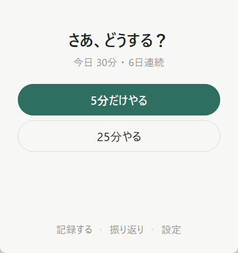
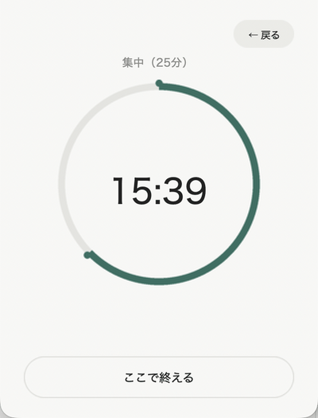
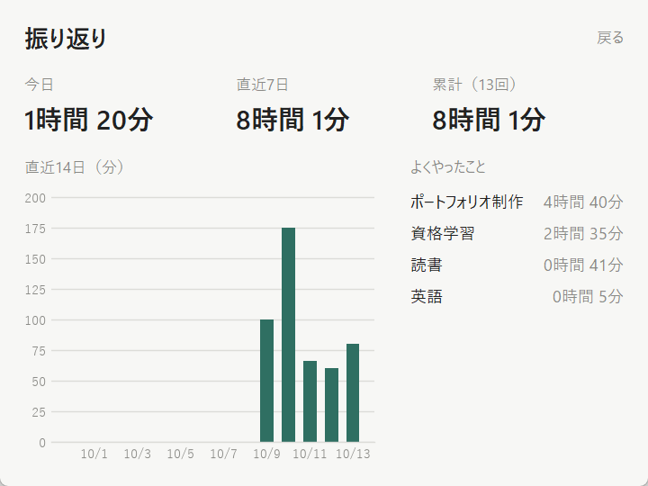
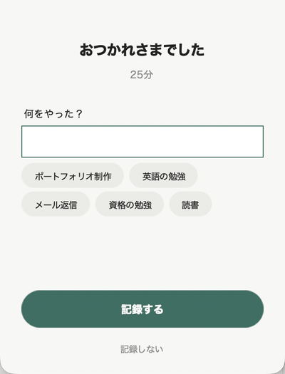
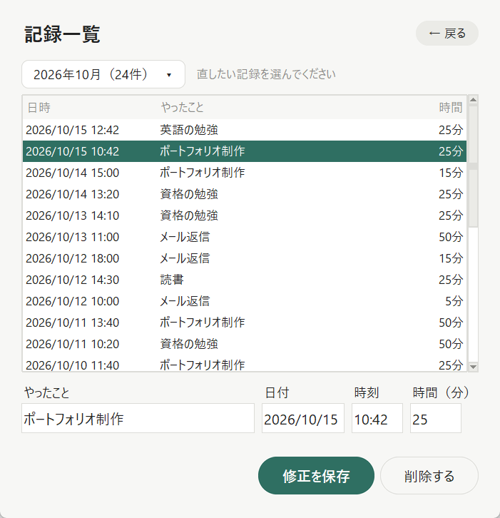
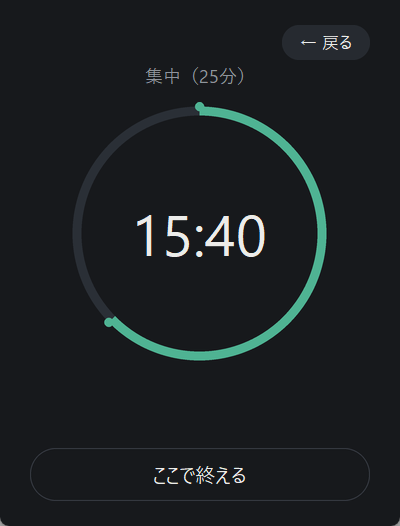

# Just do it. ⏱️

**「とりあえず5分だけやる」から始める、ポモドーロ＆作業記録アプリ**（Windows / macOS）

やる気が出ないときこそ、まずは5分。タイマーで集中し、終わったら「何をやったか」を一言記録。
記録はグラフで振り返れて、毎週メールでレポートも届きます。

| メインメニュー | タイマー | 振り返り |
| :---: | :---: | :---: |
|  |  |  |

| 記録画面 | 記録一覧 | ダークモード |
| :---: | :---: | :---: |
|  |  |  |

---

## 📥 ダウンロード

Python などのインストールは不要です。[Releases](../../releases/latest) から、使っている OS のファイルをダウンロードしてください。

| OS | ファイル | 起動のしかた |
| --- | --- | --- |
| Windows | `JustDoIt-windows.zip` | 展開して、`JustDoIt` フォルダの中の `JustDoIt.exe` をダブルクリック |
| macOS | `JustDoIt-macos.zip` | 展開した `Just do it.app` を「アプリケーション」フォルダへ移動して起動 |

> **初めて起動するときの警告について**
> コード署名をしていないため、初回だけ OS の警告が出ます。
> - **Windows**：「Windows によって PC が保護されました」→「詳細情報」→「実行」
> - **macOS**：一度開こうとしてから、「システム設定」→「プライバシーとセキュリティ」→「このまま開く」

新しいバージョンが出ると、アプリのメニューにお知らせが表示されます。新しい zip で置き換えても、これまでの記録や設定は消えません。

> **macOS で v1.3.0 以前から更新する場合**
> v1.3.1 からアプリ名が `JustDoIt.app` から `Just do it.app` に変わりました。「アプリケーション」フォルダに残っている古い `JustDoIt.app` は削除してください（記録は別の場所に保存しているので、削除しても消えません）。

---

## 🚀 使い方

1. **「5分だけやる」を押す**（Enter キーでも OK）。もっと集中したいときは「25分やる」。
2. **タイマーが終わったら、やったことを一言入力して記録**。最近やったことは、押すだけで入力できます。
3. そのまま**休憩タイマー**（初期値10分）へ。休憩が終わると、メニューに戻ります。
4. ときどき**「振り返り」**で、週・月・年ごとの作業時間をグラフで確かめる。

**さらに便利に（任意）**
- **週次レポート**：「設定」→「週次レポート」でメールアドレスを登録すると、毎週、1週間の振り返りがメールで届きます。
- **同期**：同じメールアドレスで登録した PC 同士は、記録が自動でそろいます（自宅と職場の PC など）。

---

## 🌟 主な機能

| | できること |
| --- | --- |
| ⏱️ **タイマー** | 「5分だけやる」と「○分やる」（15〜90分から選べる）、休憩タイマー、途中で終えてもそこまでの時間を記録できる |
| 📝 **記録** | タイマー終了後すぐ入力できる記録画面、最近の作業内容から選べる候補、タイマーを使わなかった作業の手動記録、記録の修正・削除 |
| 📊 **振り返り** | 週（直近7日）・月（直近30日）・年（直近12か月）の作業時間のグラフ、よくやったこと上位5件、メニューに「今日 50分 ・ 3日連続」 |
| 📧 **週次レポート** | 好きな曜日・時刻（6〜23時）に届く、グラフ入りの HTML メール。PC の電源が切れていても届く。登録後は「テストメールを送る」で、その場で届くか確かめられる |
| 🔄 **同期** | 同じメールアドレスで登録した PC 同士で、記録の追加・修正・削除がそろう |
| 🔔 **知らせ方** | タイマーが終わったら、音・ウィンドウを前面に出す・OS の通知から、好きな組み合わせで知らせる |
| 🎨 **表示** | ライト / ダーク / デバイスに合わせる を選べる。Esc キーで前の画面に戻れる |

---

## 💾 データとプライバシー

| | 内容 |
| --- | --- |
| **保存場所** | Windows：`%APPDATA%\JustDoIt\`　macOS：`~/Library/Application Support/JustDoIt/`（設定画面の「フォルダを開く」から開けます） |
| **保存されるもの** | `log/work_log.csv`（作業ログ。Excel でも開けます）、`config.json`（設定） |
| **外部に送るもの** | 週次レポートに**登録した場合だけ**、作業記録（日時・作業内容・時間）を配信サービスに送ります。登録しなければ、記録は PC の中だけに保存されます |
| **サーバーでの保存期間** | 400日で自動削除。配信を停止すると、すぐに削除されます |
| **ほかに送るもの** | 新しいバージョンの確認のため、GitHub の公開情報（最新リリース）を読み込みます。記録や設定は送りません |

> 配信サービスのスプレッドシートは開発者が管理しているため、週次レポートに登録した人の作業記録は開発者から見える状態になります。

---

## ❓ よくある質問

**Q. アップデートすると、これまでの記録は消えますか？**
消えません。記録はアプリ本体とは別の場所（上の「保存場所」）に保存しているので、アプリを新しい版に置き換えても残ります。

**Q. 同期を使うには？**
使いたいすべての PC で、同じメールアドレスを週次レポートに登録してください。起動するたびに自動で同期され、「設定」→「週次レポート」の「今すぐ同期」でも同期できます。

**Q. 1台の PC を使わなくなったら？**
その PC で「設定」→「週次レポート」の「この PC の登録を解除」を押してください。ほかの PC の同期やメールは続き、サーバーの記録も残ります。「すべての PC で配信を停止」を押すと、すべての PC の登録が解除され、サーバーに預けている記録も削除されます。

**Q. 週次レポートが届くタイミングを PC ごとに変えられますか？**
タイミングは1人につき1つです。あとから変更した PC の設定が、すべての PC に反映されます。

**Q. 不具合が起きたら？**
予期しないエラーの内容は、保存場所の `log/error.log` に記録されます。

---

## 🧩 工夫した点（開発について）

### 使いやすさ
- **作業の邪魔をしない画面**：目立つボタンは1画面に1つだけ。確認ダイアログは「記録を消す」のような取り返しがつかない操作のときだけに絞った。
- **押し間違えにくい配置**：タイマーの「記録せずにやめる」は右上の「← 戻る」に離して置き、確認を挟む。
- **記録を失わない**：作業ログを Excel で開いたままなどで保存に失敗しても、入力内容を残して保存し直せる。タイマーの途中でウィンドウを閉じようとしたときも確認する。

### Tkinter で今風の見た目にする
- **なめらかな角丸と進捗リング**：Tkinter は縁がギザギザになるため、Pillow で4倍の大きさに描いて縮小した画像で表示。
- **ライト / ダークの切り替え**：色を1つの配色オブジェクトにまとめ、入れ替えて画面を作り直すだけで切り替わる作り。ライトモードで白い背景に白い文字になる不具合を出したため、文字と背景の**コントラスト比（WCAG の基準）をテストで確かめる**ようにした。
- **Windows と macOS で同じ見た目**：OS ごとに部品の描き方が違う（Mac では標準のボタンの色が変えられない、選択欄の表示が遅れる等）ため、ボタンや選択欄を自作。

### サーバー（Google Apps Script）
- **登録はメールアドレスだけ**：開発者が配信サービスを1つ用意し、利用者はメールアドレスと確認コードだけで登録できる。端末ごとのトークン認証（サーバーにはハッシュのみ保存）、確認コードの送信回数制限で、公開しても安全に使えるようにした。
- **利用者ごとに選べる配信タイミング**：利用者ごとにトリガーを作ると数の上限にすぐ当たるため、1時間ごとのトリガー1本で「届ける時刻を過ぎた人」にだけ送る設計にした。
- **複数の PC 間の同期**：記録の内容から作る ID で同じ記録かを判断し、「消したこと」もサーバーに残すことで、ほかの PC から消した記録が戻ってこないようにした。オフライン中の変更は送信待ちキューに積み、つながったときに順番どおりに送る。

### 品質
- **配布版だけの不具合を防ぐ**：ソースでは動くのに配布版でグラフが出ない・Mac で通信できない、という不具合を出した経験から、ビルドしたアプリ自身が全画面と通信の準備を確かめる `--self-test` を作り、GitHub Actions がビルド直後に **Windows・macOS の両方で実行してから配布**するようにした。
- **単体テスト**：画面を持たない処理（集計・記録の編集・通信・同期）と画面を分けて作り、テストで確かめられるようにした。
- **通信で画面を止めない**：通信はすべて別スレッドで行い、結果だけを画面のスレッドに渡す。

---

## 🛠️ 開発者向け

### 技術スタック
| 分野 | 使っているもの |
| --- | --- |
| 言語・GUI | Python 3.10+、Tkinter、Pillow（角丸ボタン・進捗リングの描画） |
| データ処理・グラフ | pandas、Matplotlib |
| サーバー | Google Apps Script、Google スプレッドシート、Gmail |
| 配布・CI | PyInstaller、GitHub Actions |

### ディレクトリ構成
```
just-do-it/
├── main.py                    # 起動するだけ（中身は justdoit/。--self-test で動作確認）
├── justdoit/
│   ├── config.py              # 保存先・設定ファイル
│   ├── records.py             # 作業ログ（CSV）の保存・修正・削除と集計
│   ├── report_service.py      # 配信サービスとの通信・送信待ちキュー
│   ├── sync.py                # ほかの PC との同期
│   ├── notify.py              # 音・OS の通知
│   ├── updates.py             # 新しいバージョンの確認
│   ├── net.py                 # HTTPS 通信の共通処理
│   ├── selftest.py            # ビルドしたアプリの動作確認
│   └── ui/                    # 画面（app・theme・timer・history・settings・dashboard）
├── gas/report_service/        # 週次レポート配信サービス（Google Apps Script）
├── tests/                     # 単体テスト
├── docs/                      # README 用スクリーンショット（サンプルの記録で撮影）
├── JustDoIt.spec              # ビルド設定
└── .github/workflows/build.yml
```

### ソースから実行・テスト
```bash
pip install -r requirements.txt
```
```bash
python main.py
```
```bash
python -m unittest discover -s tests -v
```
画面を表示するテストは、ディスプレイのない環境では自動でスキップされます（GitHub Actions では仮想ディスプレイ上で実行）。ソースから起動した場合、記録と設定は `main.py` と同じフォルダに保存されます。

### ビルド
```bash
pip install -r requirements-dev.txt
```
```bash
pyinstaller --noconfirm JustDoIt.spec
```
`dist/` にアプリができます（Windows は `JustDoIt/JustDoIt.exe`、macOS は `Just do it.app`。それぞれの OS 上でビルドします）。表示名は「Just do it.」ですが、ファイル名・記録の保存先フォルダ名は `JustDoIt` のままにしています（Windows は名前の最後の「.」を消してしまうこと、保存先フォルダ名を変えるとこれまでの記録が見つからなくなるため）。できたアプリは、次のコマンドで全画面と通信の準備を確かめられます（結果は `selftest.log`）。
```bash
dist/JustDoIt/JustDoIt.exe --self-test
```

### リリース
1. [`justdoit/__init__.py`](justdoit/__init__.py) の `__version__` を次のバージョン（例：`1.3.0`）にして、コミット・push する
2. GitHub の **Releases →「Draft a new release」** で、同じ番号のタグ（例：`v1.3.0`）を作って公開する

GitHub Actions（[`build.yml`](.github/workflows/build.yml)）が、テスト → Windows・macOS のビルド → 配布版の動作確認 → Release への添付まで自動で行います。タグと `__version__` が違う場合は、途中で止まります。

<details>
<summary><b>週次レポート配信サービス（GAS）のデプロイ手順</b></summary>

利用者がメールアドレスを登録するだけで済むよう、配信サービスを開発者が1つだけ用意します。

1. **配信サービス専用の Google アカウント**で、Google スプレッドシートを新規作成し、「拡張機能」→「Apps Script」を開く
   - メールはこのアカウントから送られる（差出人として見える）ため、普段使いのアカウントは使わない
   - 複数のアカウントにログインしていると Apps Script が開けないことがあるので、シークレットウィンドウなどで作業する
2. [`gas/report_service/Code.js`](gas/report_service/Code.js) を貼り付ける。プロジェクトの設定で「appsscript.json をエディタで表示」をオンにし、[`appsscript.json`](gas/report_service/appsscript.json) の内容も貼り付ける
3. 「デプロイ」→「新しいデプロイ」→「ウェブアプリ」で、実行ユーザー「自分」、アクセスできるユーザー「全員」としてデプロイする
4. エディタで `createReportTrigger` を1回実行し、権限を承認する（1時間ごとに、届ける時刻を過ぎた利用者へレポートを送る）
5. 発行された URL を [`justdoit/report_service.py`](justdoit/report_service.py) の `REPORT_SERVICE_URL` に設定してビルドする（開発中は環境変数 `JUSTDOIT_REPORT_URL` でも指定できる）

**`Code.js` を直したとき**
- 「デプロイ」→「デプロイを管理」→ 鉛筆 → バージョン「新バージョン」でデプロイし直す（URL は変わらない）
- 「新しいデプロイ」にすると URL が変わり、配布済みのアプリから届かなくなるので注意
- 「毎週月曜 9時」に送っていた古いバージョンから更新した場合は、`createReportTrigger` をもう一度実行する
- 必要なシートと列は自動で作られるので、手で追加する必要はない

**制限など**
- 確認コード：同じアドレスへは1分に1回・6時間で5回まで、サービス全体で1時間に15通まで
- テストメール：1人10分に1回・1日3回まで
- 無料の Google アカウントのメール送信は1日100通程度まで（利用者が増えたら Google Workspace や外部のメール配信サービスを検討）

</details>
