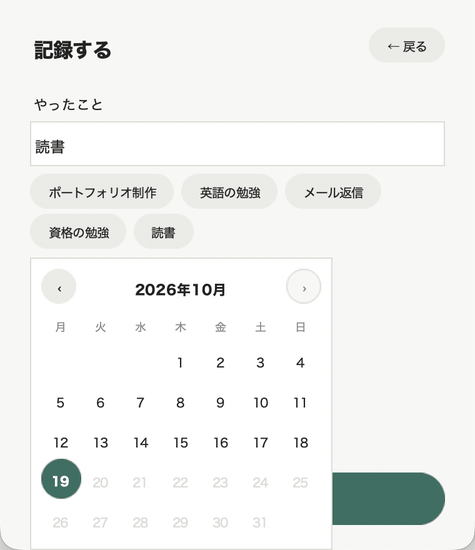
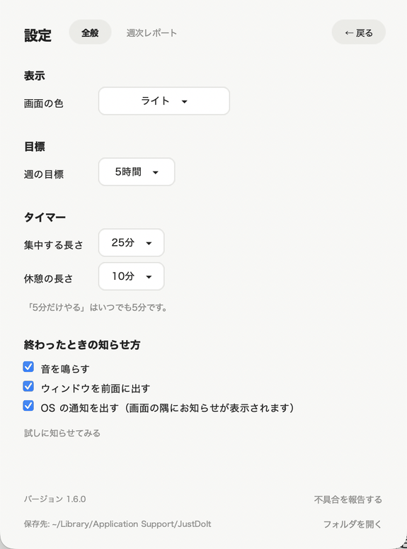
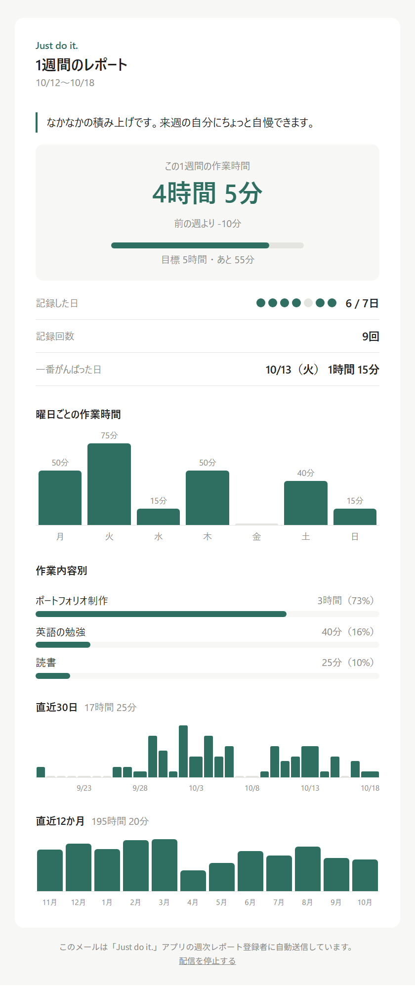
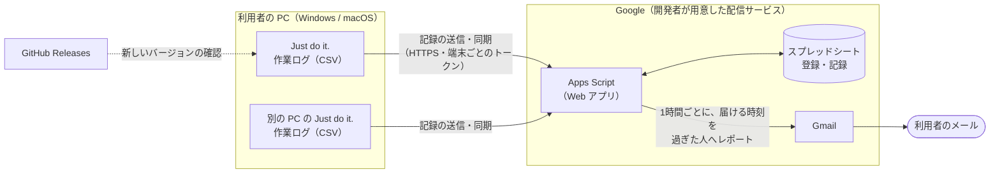

# Just do it. ⏱️

[](https://github.com/columbia0727-bit/Just_Do_It/actions/workflows/build.yml)
[](https://github.com/columbia0727-bit/Just_Do_It/releases/latest)


[](LICENSE)

**「とりあえず5分だけやる」から始める、ポモドーロ＆作業記録アプリ**（Windows / macOS）

やる気が出ないときこそ、まずは5分。タイマーで集中し、終わったら「何をやったか」を一言記録。
記録はグラフで振り返れて、毎週メールでレポートも届きます。

<p align="center"></p>

> **しくみの見どころ**（実装はすべて Claude Code。分担は[「開発のしかた」](#-開発のしかたclaude-code-との分担)、詳しくは[「工夫した点」](#-工夫した点開発について)）
> - **配布版そのものを CI で動かして確かめる**：ビルドしたアプリが全画面と通信の準備を自分で確かめる `--self-test` を作り、GitHub Actions が Windows・macOS の両方で通ってから配布する
> - **費用ゼロの配信サービス**：Google Apps Script で、週次レポートのメールと PC 間の同期を無料で動かす。利用者はメールアドレスを登録するだけで、トークンはハッシュだけを保存する
> - **問い合わせに対応しやすい**：エラーは利用者向けの言葉で知らせ、技術的な内容は OS・バージョンつきで記録に残す。設定から、原因を絞り込むのに必要な情報を1回でコピーして送ってもらえる
> - **記録を失わない**：同期は「消したこと」も残して食い違いを防ぎ、オフライン中の変更は送信待ちキューに積む。アプリや PC が落ちても、次に起動したときにタイマーの時間を記録できる

| メインメニュー | タイマー | 振り返り |
| :---: | :---: | :---: |
|  |  |  |

| 記録画面 | 記録一覧 | ダークモード |
| :---: | :---: | :---: |
|  |  |  |

| あとから記録（カレンダー） | 設定（週の目標など） | 週次レポートのメール |
| :---: | :---: | :---: |
|  |  |  |

---

## 📥 ダウンロード

Python などのインストールは不要です。[Releases](../../releases/latest) から、使っている OS のファイルをダウンロードしてください。

| OS | ファイル | 起動のしかた |
| --- | --- | --- |
| Windows | `JustDoIt-windows.zip` | 展開して、`JustDoIt` フォルダの中の `JustDoIt.exe` をダブルクリック |
| macOS | `JustDoIt-macos.zip` | 展開した `Just do it.app` を「アプリケーション」フォルダへ移動して起動 |

> **初めて起動するときの警告について**
> コード署名をしていないため、初回だけ OS の警告が出ます。
> - **Windows**：「Windows によって PC が保護されました」→「詳細情報」→「実行」
> - **macOS**：一度開こうとしてから、「システム設定」→「プライバシーとセキュリティ」→「このまま開く」

新しいバージョンが出ると、アプリのメニューにお知らせが表示されます。新しい zip で置き換えても、これまでの記録や設定は消えません。

> **macOS で v1.3.0 以前から更新する場合**
> v1.4.0 からアプリ名が `JustDoIt.app` から `Just do it.app` に変わりました。「アプリケーション」フォルダに残っている古い `JustDoIt.app` は削除してください（記録は別の場所に保存しているので、削除しても消えません）。

---

## 🚀 使い方

1. **「5分だけやる」を押す**（Enter キーでも OK）。もっと集中したいときは「25分やる」。
2. **タイマーが終わったら、やったことを一言入力して記録**。最近やったことは、押すだけで入力できます。5分で乗ってきたら「このまま続ける」で25分まで続けられます（まとめて記録されます）。
3. そのまま**休憩タイマー**（初期値10分）へ。休憩が終わると、メニューに戻ります。
4. ときどき**「振り返り」**で、週・月・年ごとの作業時間をグラフで確かめる。「通算」では、作業内容ごとにこれまで何時間やってきたかがわかります。

**さらに便利に（任意）**
- **週次レポート**：「設定」→「週次レポート」でメールアドレスを登録すると、毎週、1週間の振り返りがメールで届きます。
- **同期**：同じメールアドレスで登録した PC 同士は、記録が自動でそろいます（自宅と職場の PC など）。

---

## 🌟 主な機能

| | できること |
| --- | --- |
| ⏱️ **タイマー** | 「5分だけやる」と「○分やる」（15〜90分から選べる）、5分のあと「このまま続ける」、休憩タイマー、途中で終えてもそこまでの時間を記録できる |
| 📝 **記録** | タイマー終了後すぐ入力できる記録画面、最近の作業内容から選べる候補、タイマーを使わなかった作業の手動記録（カレンダーで日付を選べるので、前の日の作業もあとから記録できる）、記録の修正（日時も）・削除 |
| 📊 **振り返り** | 週（直近7日）・月（直近30日）・年（直近12か月）の作業時間のグラフ（「‹ 前へ」で前の期間も見られる）、前の期間と比べた一言（「前の7日より +1時間 20分」）、よくやったこと上位5件、作業内容ごとの通算（「英語の勉強 66時間 25分・166回・2025/8/21から」）、メニューに「今日 50分 ・ 3日連続」 |
| 🎯 **週の目標** | 「週3時間」のような目標を決めると、メニューに「今週 1時間 20分 / 目標 3時間」と進み具合が出る。週次レポートにも達成・あと何分かが入る（ほかの PC とも同期） |
| 📧 **週次レポート** | 好きな曜日・時刻（6〜23時）に届く、グラフ入りの HTML メール。その週の作業時間に合わせた「ひとこと」と、1週間・直近30日・直近12か月のグラフが入る。PC の電源が切れていても届く。登録後は「テストメールを送る」で、その場で届くか確かめられる。メールアドレスの変更も、記録を引き継いだままできる |
| 🔄 **同期** | 同じメールアドレスで登録した PC 同士で、記録の追加・修正・削除がそろう |
| 🔔 **知らせ方** | タイマーが終わったら、音・ウィンドウを前面に出す・OS の通知から、好きな組み合わせで知らせる |
| 🎨 **表示** | 初めて起動したときの使い方の案内、ライト / ダーク / デバイスに合わせる を選べる。Esc キーで前の画面に戻れる。Tab・Enter キーだけでも操作できる |

---

## 💾 データとプライバシー

| | 内容 |
| --- | --- |
| **保存場所** | Windows：`%APPDATA%\JustDoIt\`　macOS：`~/Library/Application Support/JustDoIt/`（設定画面の「フォルダを開く」から開けます） |
| **保存されるもの** | `log/work_log.csv`（作業ログ。Excel でも開けます）、`config.json`（設定）。週次レポートの登録トークンは、Windows では OS の「資格情報マネージャー」に、macOS では本人だけが読める `config.json` に保存します |
| **外部に送るもの** | 週次レポートに**登録した場合だけ**、作業記録（日時・作業内容・時間）を配信サービスに送ります。登録しなければ、記録は PC の中だけに保存されます |
| **サーバーでの保存期間** | 400日で自動削除。配信を停止すると、すぐに削除されます |
| **ほかに送るもの** | 新しいバージョンの確認のため、GitHub の公開情報（最新リリース）を読み込みます。記録や設定は送りません |

> 配信サービスのスプレッドシートは開発者が管理しているため、週次レポートに登録した人の作業記録は開発者から見える状態になります。

---

## ❓ よくある質問

**Q. アップデートすると、これまでの記録は消えますか？**
消えません。記録はアプリ本体とは別の場所（上の「保存場所」）に保存しているので、アプリを新しい版に置き換えても残ります。

**Q. 同期を使うには？**
使いたいすべての PC で、同じメールアドレスを週次レポートに登録してください。起動するたびに自動で同期され、「設定」→「週次レポート」の「今すぐ同期」でも同期できます。

**Q. 1台の PC を使わなくなったら？**
その PC で「設定」→「週次レポート」の「この PC の登録を解除」を押してください。ほかの PC の同期やメールは続き、サーバーの記録も残ります。「すべての PC で配信を停止」を押すと、すべての PC の登録が解除され、サーバーに預けている記録も削除されます。

**Q. 週次レポートが届くタイミングを PC ごとに変えられますか？**
タイミングは1人につき1つです。あとから変更した PC の設定が、すべての PC に反映されます。

**Q. 不具合が起きたら？**
「設定」を開き、いちばん下の「不具合を報告する」を押してください。原因を調べるための情報（バージョン・OS・最近のエラーなど。作業内容とメールアドレスは入りません）がコピーされるので、起きたことと一緒に、次のどちらかで送ってください。
- GitHub のアカウントがある場合：[不具合の報告フォーム](../../issues/new?template=bug_report.yml)（アプリから開けます）
- ない場合：justdoit.report@gmail.com へメールで

予期しないエラーの内容は、保存場所の `log/error.log` にも記録されます。

---

## 🏗️ しくみ



- **アプリ**（Python・Tkinter）：タイマー・記録・振り返りは PC の中だけで動きます。記録は CSV に保存します。
- **配信サービス**（Google Apps Script）：週次レポートに登録した人の記録を預かり、レポートのメールを送り、PC 同士の同期の中継をします。
- **GitHub Actions**：タグを作ると、テスト → Windows・macOS のビルド → 配布版の動作確認 → Releases への添付までを自動で行います。

変更の履歴は [CHANGELOG.md](CHANGELOG.md) にまとめています。

---

## 🤝 開発のしかた（Claude Code との分担）

このアプリのコードは、すべて AI のコーディングツール **Claude Code** が書いた。自分ではプログラムを書いていない。

| | やったこと |
| --- | --- |
| **自分** | 作りたいものと方針を決める（「5分だけやる」から始める、画面の項目を増やさない、レポートの「ひとこと」はくすっと笑える文にする）。Claude が出した改善案を読んで、やるかどうかを決める。ビルドしたアプリを Windows・macOS の実機で動かし、見た目や使い心地の問題を伝える。配信サービス用の Google アカウント・GitHub の設定・リリースの作成を、手順を見ながら自分で行う |
| **Claude Code** | 設計・実装・テスト・ドキュメントの下書き。改善案と、進める順番の提案。1つの変更ごとにブランチを作り、ローカルでのコミットまで |

- **確かめ方**：コミットを GitHub Desktop で1件ずつ見てから push し、プルリクエストで GitHub Actions のテスト・ビルド・配布版の動作確認が通ってから取り込む
- **失敗をルールにする**：配布版だけグラフが出なかった、OS ごとの分岐で CI が落ちた、といった失敗は、再発を防ぐ確認手順として [CLAUDE.md](CLAUDE.md) に書き足し、次からの開発で Claude に必ず守らせている

下の「工夫した点」は、Claude Code が設計・実装したものを、何のためにそうしたかがわかるようにまとめたもの。

---

## 🧩 工夫した点（開発について）

### 使いやすさ
- **作業の邪魔をしない画面**：目立つボタンは1画面に1つだけ。確認ダイアログは「記録を消す」のような取り返しがつかない操作のときだけに絞った。
- **押し間違えにくい配置**：タイマーの「記録せずにやめる」は右上の「← 戻る」に離して置き、確認を挟む。確認のボタンは「はい / いいえ」ではなく「やめてメニューに戻る」「タイマーを続ける」のように押すと何が起きるかがわかる言葉にし、取り返しがつく方を目立たせて Enter・Esc でもそちらを選ぶ（OS 標準の確認は Mac でボタンが英語になるため、アプリの中に自作した）。
- **記録を失わない**：作業ログを Excel で開いたままなどで保存に失敗しても、入力内容を残して保存し直せる。タイマーの途中でウィンドウを閉じようとしたときも確認する。アプリの強制終了や PC の電源切れに備えて、記録するまでタイマーの開始時刻と最後に動いていた時刻（30秒ごと）をファイルに残し、次に起動したときに記録できるようにした。
- **最小化していても残り時間がわかる**：画面の項目を増やさず、ウィンドウのタイトルに「12:34 集中」と出す。

### 問い合わせに対応しやすくする
- **利用者向けの言葉と、調べるための記録を分ける**：通信のエラーは「インターネットに接続できませんでした。接続を確かめて…」のように、次に何をすればよいかがわかる言葉で知らせる。英語の技術的な内容は `log/error.log` に、日時・アプリのバージョン・OS と一緒に残す。
- **聞き返さずに済む報告**：設定の「不具合を報告する」で、原因を絞り込むのに必要な情報（バージョン・OS・記録の件数・週次レポートの状態・最近のエラー）をコピーし、送り先（GitHub の報告フォーム、アカウントが無い人はメール）まで案内する。作業内容・メールアドレス・トークンは含めない。
- **報告の形を決める**：GitHub の Issue に「不具合の報告」フォームを用意し、起きたこと・手順・期待する動き・アプリからコピーした情報をそろえて書いてもらう。

### Tkinter で今風の見た目にする
- **なめらかな角丸と進捗リング**：Tkinter は縁がギザギザになるため、Pillow で4倍の大きさに描いて縮小した画像で表示。
- **ライト / ダークの切り替え**：色を1つの配色オブジェクトにまとめ、入れ替えて画面を作り直すだけで切り替わる作り。ライトモードで白い背景に白い文字になる不具合を出したため、文字と背景の**コントラスト比（WCAG の基準）をテストで確かめる**ようにした。
- **Windows と macOS で同じ見た目**：OS ごとに部品の描き方が違う（Mac では標準のボタンの色が変えられない、選択欄の表示が遅れる等）ため、ボタンや選択欄を自作。

### サーバー（Google Apps Script）
- **トークンの保管**：Windows では OS の資格情報マネージャーに保存し、設定ファイルを見られても漏れないようにした。macOS のキーチェーンを使わないのは、署名していないアプリは更新のたびにキーチェーンへのアクセスの許可（パスワード入力）を求められ、使う人の手間が大きいため。代わりに設定ファイルを本人だけが読める権限にした。
- **登録はメールアドレスだけ**：開発者が配信サービスを1つ用意し、利用者はメールアドレスと確認コードだけで登録できる。端末ごとのトークン認証（サーバーにはハッシュのみ保存）、確認コードの送信回数制限で、公開しても安全に使えるようにした。
- **利用者ごとに選べる配信タイミング**：利用者ごとにトリガーを作ると数の上限にすぐ当たるため、1時間ごとのトリガー1本で「届ける時刻を過ぎた人」にだけ送る設計にした。
- **複数の PC 間の同期**：記録の内容から作る ID で同じ記録かを判断し、「消したこと」もサーバーに残すことで、ほかの PC から消した記録が戻ってこないようにした。オフライン中の変更は送信待ちキューに積み、つながったときに順番どおりに送る。

### 品質
- **配布版だけの不具合を防ぐ**：ソースでは動くのに配布版でグラフが出ない・Mac で通信できない、という不具合を出した経験から、ビルドしたアプリ自身が全画面と通信の準備を確かめる `--self-test` を作り、GitHub Actions がビルド直後に **Windows・macOS の両方で実行してから配布**するようにした。各画面の中身がウィンドウに収まっているかも確かめ、全画面のスクリーンショットも残すので、Windows の PC が手元に無くても見た目を確かめられる。
- **単体テスト**：画面を持たない処理（集計・記録の編集・通信・同期）と画面を分けて作り、テストで確かめられるようにした。
- **通信で画面を止めない**：通信はすべて別スレッドで行い、結果だけを画面のスレッドに渡す。

---

## 🛠️ 開発者向け

### 技術スタック
| 分野 | 使っているもの |
| --- | --- |
| 言語・GUI | Python 3.12+、Tkinter、Pillow（角丸ボタン・進捗リングの描画） |
| データ処理・グラフ | pandas、Matplotlib |
| サーバー | Google Apps Script、Google スプレッドシート、Gmail |
| 配布・CI | PyInstaller、GitHub Actions |

### ディレクトリ構成
```
just-do-it/
├── main.py                    # 起動するだけ（中身は justdoit/。--self-test で動作確認）
├── justdoit/
│   ├── config.py              # 保存先・設定ファイル
│   ├── records.py             # 作業ログ（CSV）の保存・修正・削除と集計
│   ├── focus.py               # 集中タイマーの判断（残り時間・記録する分数・続けられるか）
│   ├── report_service.py      # 配信サービスとの通信・送信待ちキュー
│   ├── sync.py                # ほかの PC との同期
│   ├── notify.py              # 音・OS の通知
│   ├── updates.py             # 新しいバージョンの確認
│   ├── net.py                 # HTTPS 通信の共通処理
│   ├── selftest.py            # ビルドしたアプリの動作確認
│   ├── support.py             # 不具合の報告に使う情報と送り先（設定の「不具合を報告する」）
│   └── ui/                    # 画面（app・theme・datepicker・timer・history・dashboard・settings・report_settings）
├── gas/report_service/        # 週次レポート配信サービス（Google Apps Script）
├── tests/                     # 単体テスト
├── tools/
│   ├── release_notes.py       # CHANGELOG.md からリリースノートを作る（リリース時に Actions が実行）
│   ├── readme_screenshots.py  # README 用スクリーンショットを、サンプルの記録で撮り直す
│   └── readme_demo.py         # README の冒頭のデモ（docs/demo.gif）を、アプリを自動で操作して作る
├── docs/                      # README 用スクリーンショットとデモ（tools/ のスクリプトがサンプルの記録で作る）
├── JustDoIt.spec              # ビルド設定
├── CLAUDE.md                  # Claude Code で開発するときの決まりごと
└── .github/                   # GitHub Actions（workflows/）、不具合の報告フォーム（ISSUE_TEMPLATE/）
```

### ソースから実行・テスト
```bash
pip install -r requirements.txt
```
```bash
python main.py
```
```bash
python -m unittest discover -s tests -v
```
コードの書き方・型のチェックと、週次レポート配信サービス（GAS）のテスト（Node.js が必要）：
```bash
python -m ruff check .
```
```bash
python -m mypy
```
```bash
node gas/tests/run.js
```
型のチェックは、使っている OS として行われます。ほかの OS 向けの処理も確かめるには `--platform win32`（`linux`・`darwin`）を付けます（GitHub Actions では3つとも確かめます）。
GAS のテストは、本物の配信サービスのコード（`gas/report_service/*.js`）を模擬環境（スプレッドシート・メール・時計を手元で再現したもの）に読み込み、登録・同期・レポートの配信タイミングなどを確かめます。GitHub Actions では、これらをすべて毎回実行します。
画面を表示するテストは、ディスプレイのない環境では自動でスキップされます（GitHub Actions では仮想ディスプレイ上で実行）。

依存ライブラリは、動作を確かめたバージョンに固定しています（`requirements.txt`）。新しいバージョンが出ると Dependabot がプルリクエストを作り、GitHub Actions のテストと配布版の動作確認が通ってから取り込みます。ソースから起動した場合、記録と設定は `main.py` と同じフォルダに保存されます。

### ビルド
```bash
pip install -r requirements-dev.txt
```
```bash
pyinstaller --noconfirm JustDoIt.spec
```
`dist/` にアプリができます（Windows は `JustDoIt/JustDoIt.exe`、macOS は `Just do it.app`。それぞれの OS 上でビルドします）。表示名は「Just do it.」ですが、ファイル名・記録の保存先フォルダ名は `JustDoIt` のままにしています（Windows は名前の最後の「.」を消してしまうこと、保存先フォルダ名を変えるとこれまでの記録が見つからなくなるため）。できたアプリは、次のコマンドで全画面と通信の準備を確かめられます（結果は `selftest.log`）。
```bash
dist/JustDoIt/JustDoIt.exe --self-test
```
`--screenshots screenshots` も付けると、全画面のスクリーンショット（ライト・ダーク）を `screenshots/` に保存します。GitHub Actions では Windows・macOS それぞれで撮り、実行ページの「Artifacts」（`screenshots-Windows`・`screenshots-macOS`）からダウンロードできます。手元に Windows の PC が無くても、Windows での見た目を確かめられます。

### 開発の進め方
1. 変更ごとにブランチを作る（例：`feature/weekly-goal`）
2. プルリクエストを作ると、GitHub Actions がテスト・ビルド・配布版の動作確認を行う（[ひな形](.github/pull_request_template.md)の確認項目も見る）
3. すべて成功したら main に取り込む

利用者に関わる変更は、[CHANGELOG.md](CHANGELOG.md) の「未リリース」に書いておきます（リリースノートになります）。テストのカバレッジ（テストが通ったコードの割合）は、Actions の各実行の Summary に表で出ます。集計・同期・通信の処理（`records.py`・`sync.py`・`report_service.py` など）は 9 割以上をテストで通しています。画面のコードは、ビルドしたアプリの `--self-test` が Windows・macOS で全画面を開いて確かめています。

### リリース
1. [`justdoit/__init__.py`](justdoit/__init__.py) の `__version__` を次のバージョン（例：`1.5.0`）にし、[CHANGELOG.md](CHANGELOG.md) の「未リリース」を `## [1.5.0] - 日付` にして main に取り込む
2. GitHub の **Releases →「Draft a new release」** で、同じ番号のタグ（例：`v1.5.0`）を作って公開する（説明文は空でよい）

GitHub Actions（[`build.yml`](.github/workflows/build.yml)）が、テスト → Windows・macOS のビルド → 配布版の動作確認 → Release への添付まで自動で行い、説明文には CHANGELOG.md のそのバージョンの部分（[`tools/release_notes.py`](tools/release_notes.py)）が入ります。タグと `__version__` が違う場合や、CHANGELOG.md にそのバージョンが無い場合は、途中で止まります。

<details>
<summary><b>週次レポート配信サービス（GAS）のデプロイ手順</b></summary>

利用者がメールアドレスを登録するだけで済むよう、配信サービスを開発者が1つだけ用意します。

1. **配信サービス専用の Google アカウント**で、Google スプレッドシートを新規作成し、「拡張機能」→「Apps Script」を開く
   - メールはこのアカウントから送られる（差出人として見える）ため、普段使いのアカウントは使わない
   - 複数のアカウントにログインしていると Apps Script が開けないことがあるので、シークレットウィンドウなどで作業する
2. [`gas/report_service/`](gas/report_service/) の `.js` ファイルをすべて、同じ名前のスクリプトとして貼り付ける。プロジェクトの設定で「appsscript.json をエディタで表示」をオンにし、[`appsscript.json`](gas/report_service/appsscript.json) の内容も貼り付ける（下の自動デプロイを設定すれば、この手順は1回目の `push` で済む）
3. 「デプロイ」→「新しいデプロイ」→「ウェブアプリ」で、実行ユーザー「自分」、アクセスできるユーザー「全員」としてデプロイする
4. エディタで `createReportTrigger` を1回実行し、権限を承認する（1時間ごとに、届ける時刻を過ぎた利用者へレポートを送る）
5. 発行された URL を [`justdoit/report_service.py`](justdoit/report_service.py) の `REPORT_SERVICE_URL` に設定してビルドする（開発中は環境変数 `JUSTDOIT_REPORT_URL` でも指定できる）

**自動デプロイ（GitHub Actions + clasp）**

`gas/report_service/` を変えて main に取り込むと、[`deploy-gas.yml`](.github/workflows/deploy-gas.yml) がテストを通してから、今のデプロイを新しいバージョンに更新する（URL は変わらない）。最初に1回だけ、次の準備をする（すべて無料）。
1. 配信サービス用の Google アカウントで [Apps Script の設定](https://script.google.com/home/usersettings) を開き、「Google Apps Script API」をオンにする
2. Node.js を入れた PC で `npx @google/clasp@2.4.2 login` を実行し、同じアカウントでログインする（ホームフォルダに `.clasprc.json` ができる）
3. GitHub の「Settings」→「Secrets and variables」→「Actions」に、次の3つを登録する
   - `CLASPRC_JSON`：`.clasprc.json` の中身
   - `GAS_SCRIPT_ID`：Apps Script の「プロジェクトの設定」にあるスクリプト ID
   - `GAS_DEPLOYMENT_ID`：「デプロイを管理」にある、ウェブアプリのデプロイ ID

**手で直すとき（自動デプロイを使わない場合）**
- 「デプロイ」→「デプロイを管理」→ 鉛筆 → バージョン「新バージョン」でデプロイし直す（URL は変わらない）
- 「新しいデプロイ」にすると URL が変わり、配布済みのアプリから届かなくなるので注意
- 「毎週月曜 9時」に送っていた古いバージョンから更新した場合は、`createReportTrigger` をもう一度実行する
- 必要なシートと列は自動で作られるので、手で追加する必要はない

**制限など**
- 確認コード：同じアドレスへは1分に1回・6時間で5回まで、サービス全体で1時間に15通まで
- テストメール：1人10分に1回・1日3回まで
- 無料の Google アカウントのメール送信は1日100通程度まで（利用者が増えたら Google Workspace や外部のメール配信サービスを検討）

</details>
